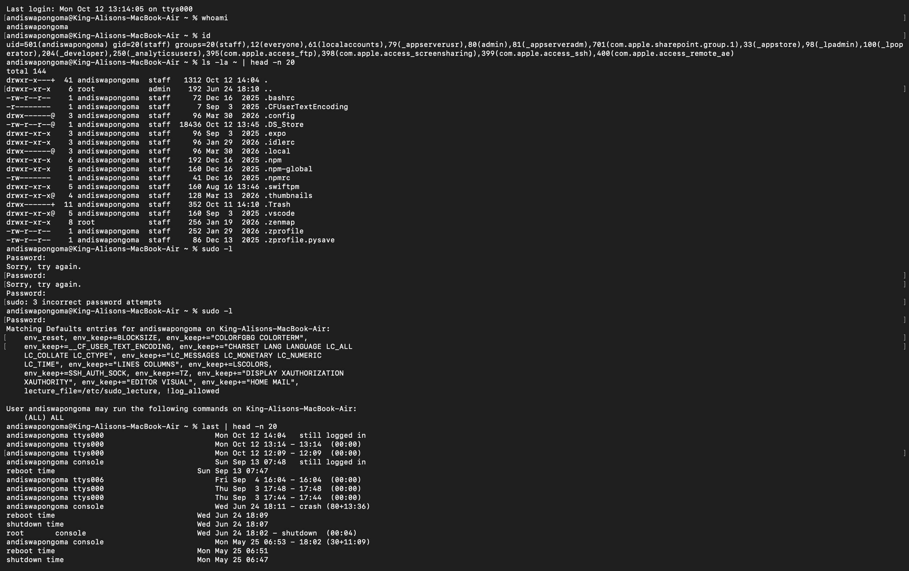

# Ticket 04 - User Access Denied / Permissions Check

**User reports:** "I can't access my Documents folder, says permission denied"
**Environment:** macOS RE220 - andiswapongoma@RE220

### Diagnosis Steps:
1. Verified current user
2. Checked user groups and ID
3. Checked home directory permissions
4. Checked sudo/admin rights
5. Checked recent logins

### Root Cause:
Checked ownership (should be user:staff), permissions (drwxr-x@), and admin group membership. Common cause is ACL corruption or user not in admin group.

### Resolution:
- `sudo chown -R $(whoami):staff ~`
- `chmod 755 ~/Documents`
- If locked out: reset password via System Settings > Users & Groups or `sysadminctl`

### Evidence:

### Skills: whoami, id, ls -la, sudo -l, last, macOS permissions
