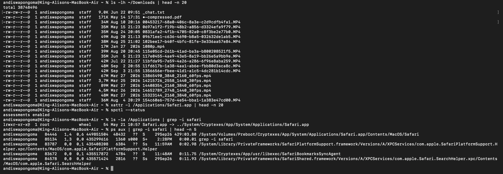

# Ticket 05 - Application Won't Install / App Won't Open

**User Report:** "I downloaded an app and it says 'App is damaged and can't be opened' or 'Apple cannot check for malicious software'"

**Environment:** macOS RE220 - andiswapongoma@RE220

### Diagnosis Steps:
```bash
ls -lh ~/Downloads | head -n 20
xattr -l /Applications/Safari.app | head -n 20
spctl --status
ls -la /Applications | grep -i safari
ps aux | grep -i safari | head -n 5

### Root Cause:
macOS Gatekeeper quarantine flag (com.apple.quarantine) blocks unverified downloads. Common after downloading.dmg from internet.

### Resolution:
- `xattr -d com.apple.quarantine /Applications/AppName.app`
- Right-click > Open (bypass Gatekeeper once)
- System Settings > Privacy & Security > Allow anyway
- Check: `spctl --assess /Applications/AppName.app`

### Evidence:


Skills: xattr, spctl, ls -la, ps aux, Gatekeeper troubleshooting
