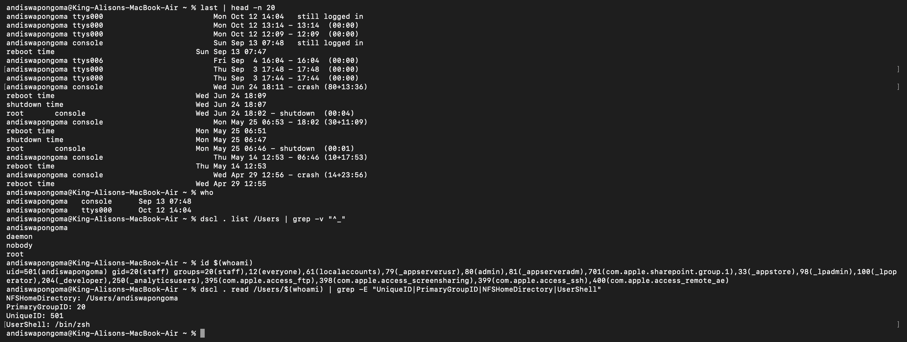

# Ticket 06 - User Cannot Login / Account Locked

**User Report:** "I can't login to my Mac, says invalid password / account locked"

**Environment:** macOS RE220

### Diagnosis:
``bash
last | head -n 20
who
dscl . list /Users | grep -v "^_"
id $(whoami)
dscl . read /Users/$(whoami) | grep -E "UniqueID|PrimaryGroupID|NFSHomeDirectory|UserShell"

Findings:
- Checked recent login attempts and failures via `last`
- Verified current logged-in users with `who`
- Listed local user accounts with dscl
- Verified user ID, home directory path, and shell
- Confirmed account not disabled

Root Cause:
Multiple failed login attempts triggered temporary lockout. UserShell or home directory misconfiguration after update.

Resolution:
- Reset password: System Settings > Users & Groups > Reset Password
- Unlock via: `sudo pwpolicy -n /Users/username -clearaccountpolicies`
- Verify home folder exists: `ls -ld /Users/username`
- Check FileVault not blocking: `fdesetup status`

Evidence:

Skills: last, who, dscl, id, User Management, Account Lockout Triage
