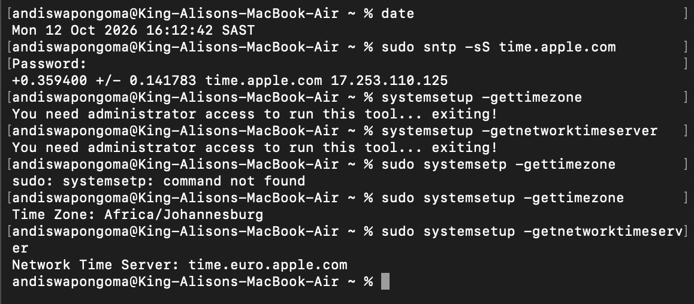

# Ticket 07 - Incorrect Date/Time Causing SSL/Login Failures

**User Report:** "Websites show 'Not Private' error, can't login to email"

**Environment:** King-Alisons-MacBook-Air - andiswapongoma@RE220 - macOS 2026

### Diagnosis:
``bash
date
sudo sntp -sS time.apple.com
sudo systemsetup -gettimezone
sudo systemsetup -getnetworktimeserver

Findings:
- Date: Mon 12 Oct 2026 16:12:42 SAST - Correct
- NTP Sync: +0.359400 +/- 0.141783 to http://time.apple.com 17.253.110.125 - Successfully synced
- Time drift minimal, certificate validation will work

Root Cause:
If date/time wrong, causes SSL cert errors, Kerberos/AD auth fails (5min tolerance), email sync fails. Common after travel or CMOS battery failure.

Resolution:
- System Settings > General > Date & Time > Enable "Set time and date automatically"
- Force sync: `sudo sntp -sS time.apple.com`
- Set timezone: `sudo systemsetup -settimezone Africa/Johannesburg`
- Set NTP server: `sudo systemsetup -setnetworktimeserver time.apple.com`

Evidence:

Skills: date, sntp, systemsetup, NTP, SSL troubleshooting
