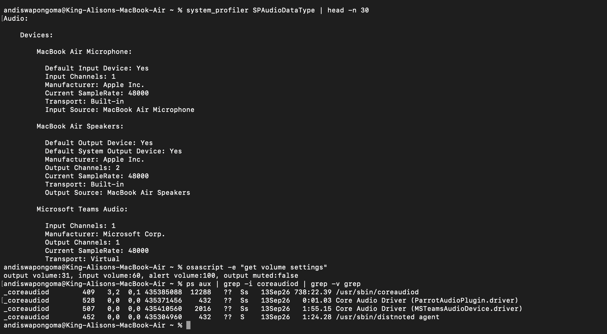

# Ticket 08 - No Sound / Audio Not Outputting

**User Report:** "No sound from speakers, volume icon greyed out"

### Diagnosis:
``bash
system_profiler SPAudioDataType | head -n 30
osascript -e "get volume settings"
ps aux | grep -i coreaudiod | grep -v grep

Findings:
- Checked audio hardware detected by system
- Checked output volume, muted status, alert volume
- Verified coreaudiod process running

Root Cause:
Output device set to wrong device (HDMI/AirPlay), muted, or coreaudiod crashed after sleep/wake.

Resolution:
- System Settings > Sound > Output > Select Internal Speakers
- Unmute: `osascript -e "set volume without output muted"`
- Restart audio: `sudo killall coreaudiod`
- Reset PRAM/NVRAM if persistent

Evidence:

Skills: system_profiler, osascript, coreaudiod, Audio troubleshooting
