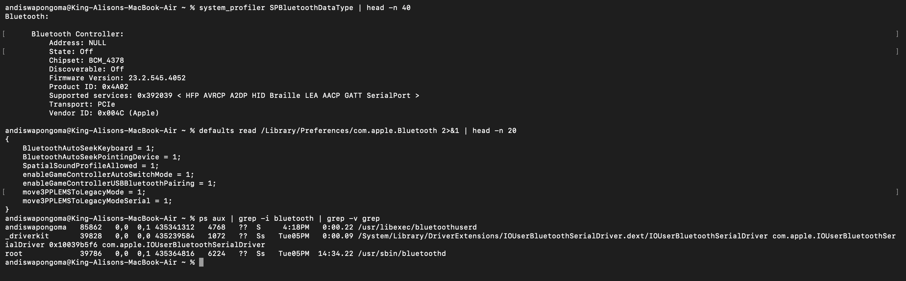

# Ticket 09 - Bluetooth Not Working / Device Won't Pair

**User Report:** "Bluetooth won't find mouse/keyboard, can't connect"

### Diagnosis:
``bash
system_profiler SPBluetoothDataType | head -n 40
defaults read /Library/Preferences/com.apple.Bluetooth
ps aux | grep -i bluetooth

Findings:
- Verified Bluetooth hardware & power status
- Checked pairing list and preferences
- Confirmed bluetoothd process active

Root Cause:
Bluetooth cache corrupted, device out of range/battery dead, interference, or bluetoothd hang after sleep.

Resolution:
- System Settings > Bluetooth > Off/On
- Reset module: Hold Shift+Option > Click Bluetooth icon > Reset
- Delete device and re-pair
- Terminal: `sudo pkill bluetoothd` + `sudo rm /Library/Preferences/com.apple.Bluetooth.plist`

Evidence:

Skills: system_profiler, bluetoothd, defaults, Device pairing
