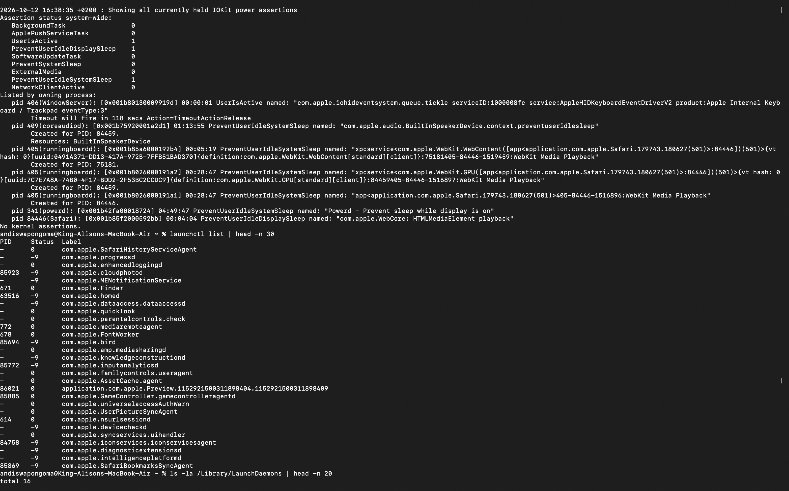

# Ticket 10 - Slow Boot / Too Many Startup Items / Boot Failure

**User Report:** "Mac takes forever to start, stuck on Apple logo"

### Diagnosis:
``bash
pmset -g log | tail -n 30
launchctl list | head -n 30
ls -la /Library/LaunchDaemons | head -n 20
ls ~/Library/LaunchAgents

Findings:
- Checked last wake/sleep/shutdown causes
- Listed launch agents/daemons loading at boot
- Identified heavy startup items

Root Cause:
Too many LaunchAgents, failing daemon, full disk preventing boot cache, or unclean shutdown.

Resolution:
- Safe Mode: Hold Shift at boot to bypass login items
- System Settings > General > Login Items > Remove unnecessary
- Disable: `launchctl unload ~/Library/LaunchAgents/com.example.plist`
- Verify disk: `diskutil verifyVolume /`
- Reset SMC/PRAM if boot hang

Evidence:

Skills: pmset, launchctl, LaunchDaemons, Boot troubleshooting, Safe Mode
